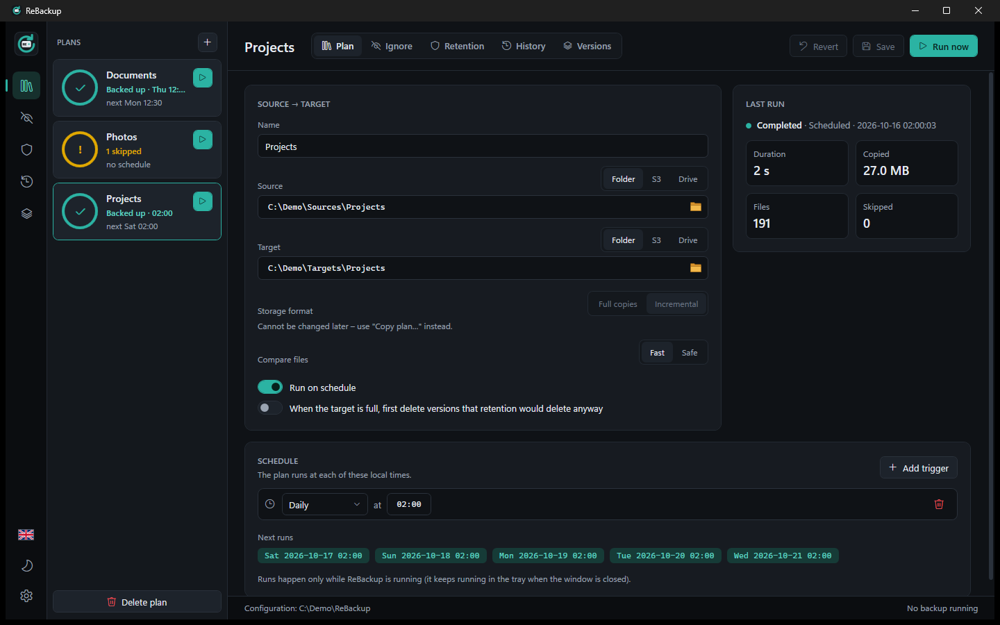
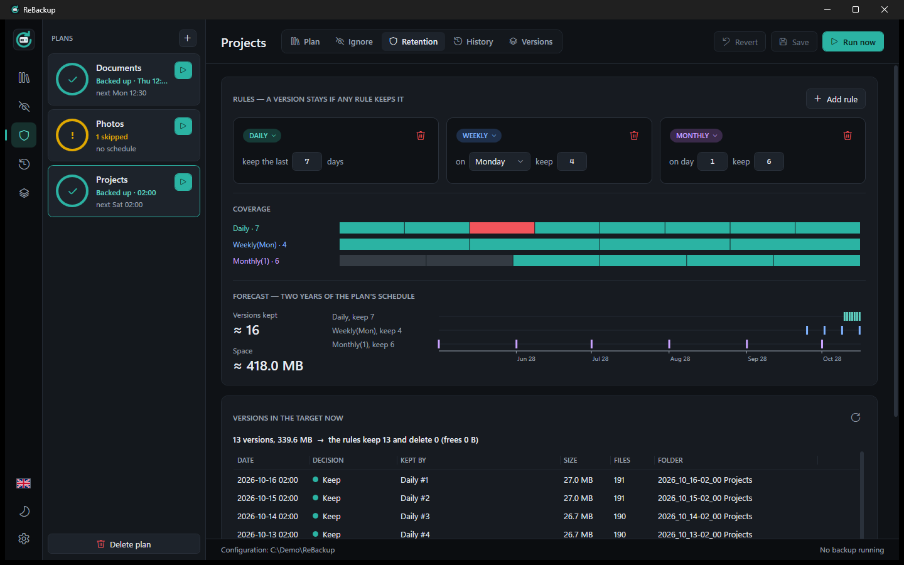
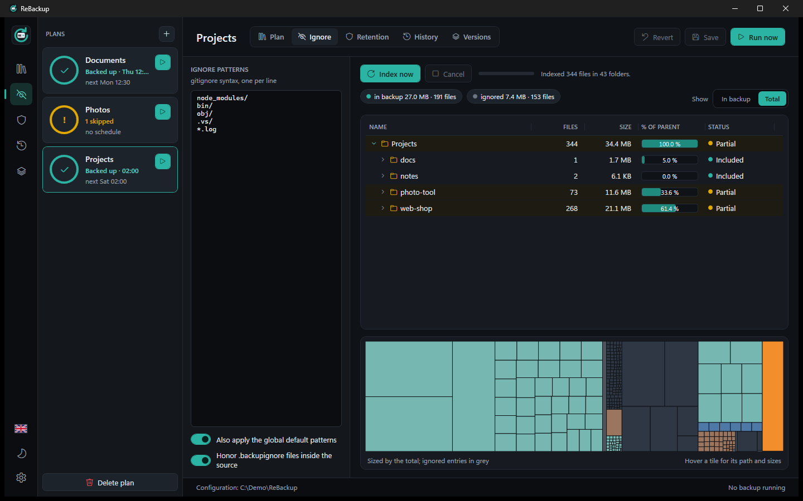
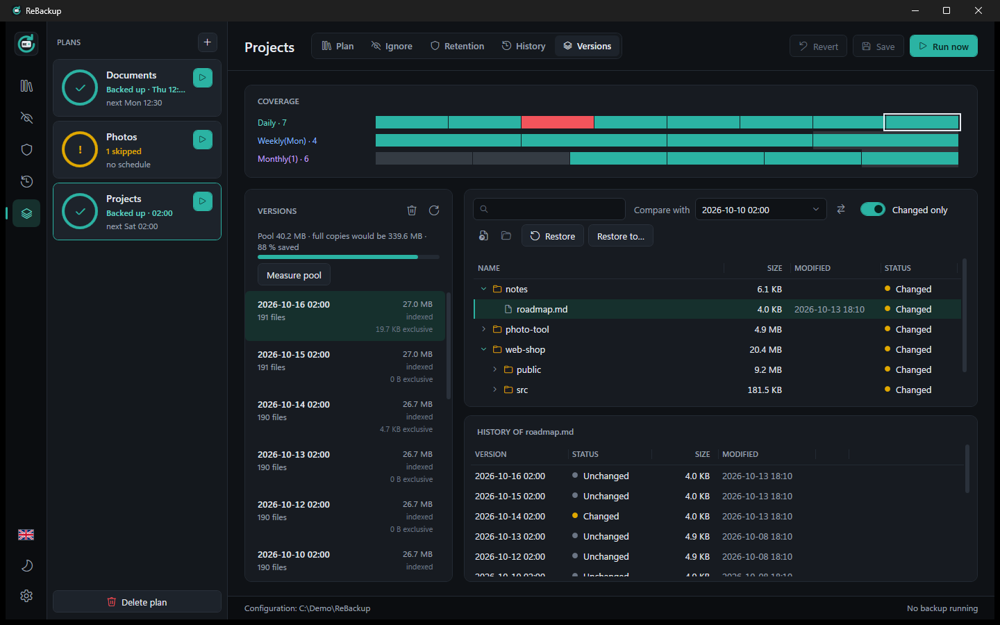
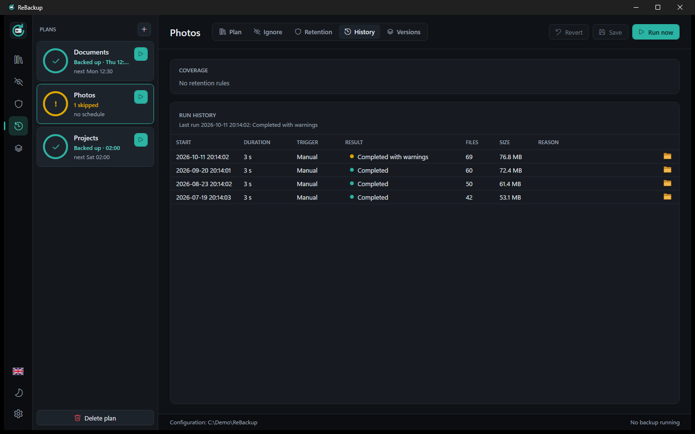
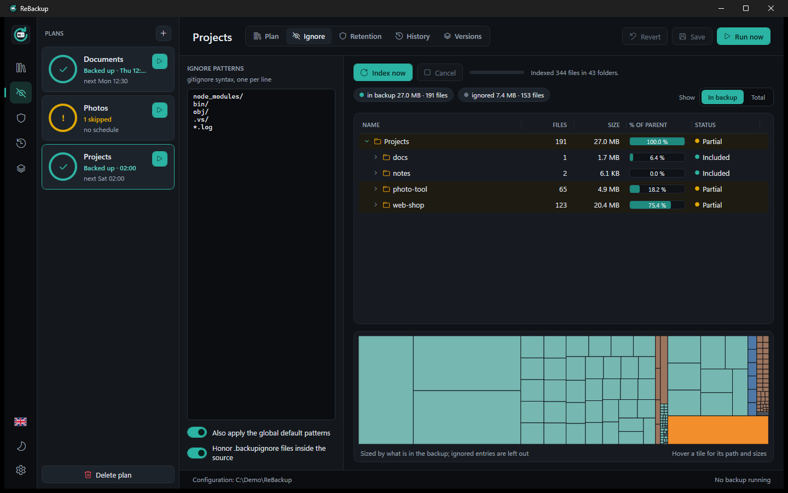
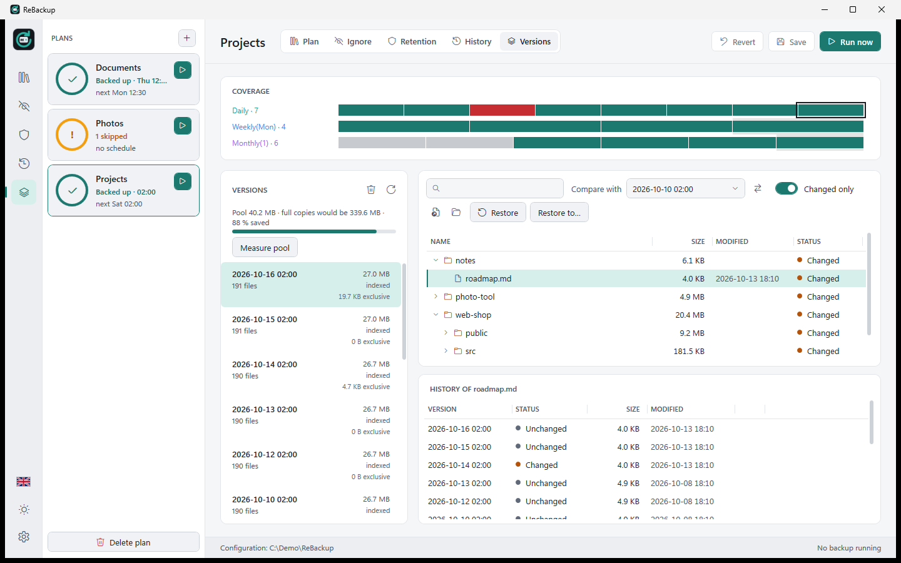
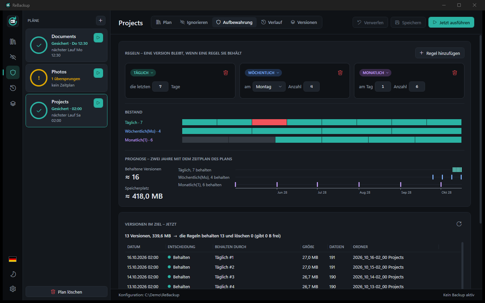

<p align="center">
  
</p>

<h1 align="center">ReBackup</h1>

<p align="center">
  A Windows backup manager for folders: plain full copies or deduplicated incremental versions on a schedule,
  retention rules you can see the effect of, and a preview that shows what goes into the backup before it runs.
</p>

<p align="center">
  
  
  
  
</p>

<p align="center">
  Made by <a href="https://moon-labs.io">Moon Labs UG (haftungsbeschränkt)</a>
</p>



---

## Highlights

### Retention you can predict

- **Anchored rules**: keep the last *n* days, weeks (from a weekday), months (from a day of the month) or years
  (from a date). For example *daily 7 · weekly Sunday 4 · monthly 1st 12*.
- **A version stays if any rule keeps it.** The newest version always stays. Each version shows which rules keep it
  (`Daily #2, Monthly(1) #1`).
- **Live "now" preview**: while you edit the rules, the list of versions in the target shows *Keep* or *Delete* for
  each one, plus how much space the deletions would free.
- **Two-year forecast**: ReBackup simulates the plan's own schedule for two years and shows how many versions the
  target will hold, about how much space they need, and a timeline of which rule keeps which version.
- **Coverage timeline**: the Retention and Versions tabs show, for each rule, the slots it wants to keep (days, weeks,
  months, years) and whether a version exists for each: green present, yellow present with warnings (its run skipped
  files), red missing, grey before the first backup or not yet run. A missing day stands out at a glance; click a slot
  to select its version.



### Incremental backups without chains

- **Every version is complete.** An incremental plan stores each distinct file content once in a pool on the target;
  a version is only its manifest. There is no chain of increments: retention can delete any version on its own, and a
  restore never has to merge anything.
- **See what it saves.** The Versions tab shows the pool size next to what full copies would need, with a bar for the
  savings (*Pool 40 MB · full copies would be 340 MB · 88 % saved*). **Measure pool** lists the pool on the target and
  shows its real size, including content no version references any more. Full plans show how much all their versions
  take together.
- **Safe by design.** Contents are written and verified before a manifest refers to them, cleanup never removes what a
  remaining version needs, and every restore checks each file against its hash. Interrupted deletions resume when
  ReBackup starts again. Switch a plan between full and incremental with **Copy plan…**. Details in
  [Storage formats](#storage-formats).

### Ignore & Preview

- **gitignore syntax**: `node_modules/`, `*.tmp`, `!keep.tmp`, `**`, anchored `/build/` and so on, matched without
  regard to case. Global default patterns (`Thumbs.db`, `desktop.ini`, `$RECYCLE.BIN/`,
  `System Volume Information/`) and nested **`.backupignore`** files inside the source add to the plan's patterns.
- **Live, parallel scan**: the source is scanned four folders at a time. Folders show up at once and can be
  expanded while the scan is still running. Sizes and ignore status fill in as files are found.
- **Tree and treemap, like WinDirStat**: size, file count and *% of parent* bars, plus a squarified treemap coloured
  by file extension. Click a tile to find it in the tree; select a row to outline it in the treemap.
- **In backup / Total**: show only what will be backed up, or everything with the ignored parts in grey.
- **Why is this ignored?** The tooltip names the pattern and where it came from (plan, global defaults or a
  `.backupignore` file). From the context menu you can ignore an entry, ignore every file with its extension, or
  un-ignore it. Pattern changes are applied to the cached scan without scanning again.
- **`.backupignore` files stay visible**: they are marked in every overview (filter icon, bold; folders that hold one get
  a badge; a distinct treemap colour), and a **.backupignore (n)** chip lists them all.
- **What does each line do?** Click a `.backupignore` to see its lines with the number of entries and bytes each one
  currently excludes. Lines that match nothing are greyed. **Open in editor** jumps to the file.
- **Relocate rules, with a preview**: right-click a `.backupignore` and choose **Integrate into plan…** (its rules move
  into the plan with the folder prefixed; the file goes to the recycle bin, or is renamed to `.backupignore.integrated`
  on drives without one). Right-click a folder and choose **Move selected rules to <folder>/.backupignore…** for the
  other way round. The dialog shows both diffs and checks against the scanned files whether the backup scope stays
  exactly the same (green) or which entries change (red, needs **Apply anyway**). Folder sources only.



---

## Features

| Area | What you get |
|---|---|
| **Plans** | One source and one target per plan, each a folder, an **Amazon S3** location (connection + prefix) or a **Google Drive** location (shared drive or folder + path), any number of plans. Turn off "Run on schedule" for manual-only plans. Optionally, when the target is full, delete the versions that retention would delete anyway before giving up. |
| **Schedules** | Triggers: **Daily** (time), **Weekly** (weekdays + time), **Monthly** (day 1–31, `0` = last day, `-1` = the day before it), **Interval** (every *n* hours between two times). Shows the next five runs. On startup, a plan that missed a trigger gets **one catch-up run** about a minute later. |
| **Versions** | By default, every run is a **full copy** in its own folder `YYYY_MM_DD-hh_mm <Plan>` with a `re-manifest.json` that lists every file with size, modification time and an **xxHash64** hash. No archive format: a version is an ordinary folder you can open in Explorer. Plans can instead be **incremental** (see [Storage formats](#storage-formats)). |
| **Retry skipped files** | Files that were locked, refused or changed while they were copied are tried again after the run and added to the same version: by default 3 attempts, 5 minutes apart. Set per plan (see [How it works](#how-it-works)). |
| **Run history** | Start, duration, trigger (manual, scheduled, catch-up), result, files, size. Select a run to see skipped files and versions deleted by retention. Results: completed, completed with warnings, target full, error, canceled. |
| **Ignore tab** | Scans the source live and shows, per file and folder, what goes into the backup and what the gitignore-style patterns leave out (tree and treemap). **Compare with** a version of the plan to see its size and the difference per entry — growth in red, shrinking in green — to find unwanted gains before the next run. `.backupignore` files are marked and can be moved into the plan or out of it with a scope-equivalence check. |
| **Versions tab** | Browse any version, search names (substring or `*`/`?`), **compare two versions** (added / changed / deleted with both sizes and the size difference, optionally changed only), and see a **file's history** across all versions. **Delete versions** by hand (one or several, after a confirmation), with the progress of the deletion, the cleanup and the indexing shown in the tab and on the plan's card. A size header shows how much the versions need (and, for incremental plans, how much the pool saves). Backed by a local SQLite index per plan. |
| **Restore** | Restore a file, a folder or a whole version to its original location or to a folder of your choice. If files already exist you choose **Overwrite**, **Skip** or **Keep both** (or cancel). A restore **never deletes** anything at the destination. |
| **App** | **Dark and Light** theme, **English and German** (both switch at once, no restart), tray icon with Open, Run plan, Pause scheduler and Exit, a notification when a run ends, start with Windows, a single instance. |
| **Distribution** | One self-contained `.exe` for Windows x64; no installer, no .NET runtime to install. |

### A closer look

**Versions: compare, file history, restore.** Pick a version, compare it with another one, and select a file to
see what happened to it in every version. This is an incremental plan: the header above the versions shows the pool
next to what full copies would take, and each version shows how much content only it holds (*exclusive*).



**History.** Every run is logged, including canceled ones and the files that were skipped.



**Ignore & Preview, "In backup" view.** Only what will be backed up counts; ignored folders show `—`.



**Light theme and German.** Theme and language are switched from the left rail or in Settings and apply at once.

| Light theme | Deutsch |
|---|---|
|  |  |

---

## Getting started

### Run the exe

1. Get `ReBackup-<version>-win-x64.exe` from the [releases](https://github.com/MoonLabsDev/re-backup/releases) of
   this repository, or build it yourself (below).
2. Start it. There is no installer; the exe can live in any folder.
3. Create a plan with **+** next to *PLANS*: name, source folder, target folder.
4. Check the **Ignore** tab: press **Index now**, look at the tree and treemap, and adjust the patterns.
5. Set up the schedule on the **Plan** tab and the rules on the **Retention** tab, then **Save** (Ctrl+S).
6. Press **Run now**, or let the schedule run. Closing the window keeps ReBackup in the tray.

Requirements: Windows 10 or 11 (x64; an arm64 build can be published, see below).

### Build from source

Needs the [.NET 9 SDK](https://dotnet.microsoft.com/download/dotnet/9.0).

```powershell
dotnet build                                  # whole solution: app, core library and tests
dotnet test                                   # the core test suite
dotnet run --project src/ReBackup.App         # start the app
```

### Publish a single exe

`publish.ps1` publishes the app in Release as one file and copies it to `dist\`.

```powershell
.\publish.ps1                       # dist\ReBackup-2.3.2-win-x64.exe, self-contained (.NET runtime included)
.\publish.ps1 -Version 1.5.1        # override the version from Directory.Build.props
.\publish.ps1 -FrameworkDependent   # dist\ReBackup-2.3.2-win-x64-fd.exe, small, needs the .NET 9 Desktop Runtime
.\publish.ps1 -Runtime win-arm64    # for Windows on ARM
```

---

## How it works

```
plan ─► scan source ─► apply ignore patterns ─► reserve "YYYY_MM_DD-hh_mm <Plan>" with re-pending.json
     ─► copy (hashing while copying) ─► write re-manifest.json ─► remove re-pending.json ─► apply retention
```

1. **Preflight.** The source must exist. ReBackup scans it, applies the ignore patterns and checks that the target
   has room for the included size plus 5 %. If not, and the plan allows it, it first deletes versions that
   retention would delete anyway; otherwise the run ends as *target full* before anything is written.
2. **Copy.** The version folder is reserved by creating `re-pending.json` in it; while that marker is there, the
   folder is not a version. Files are copied into it with their relative paths and modification times; each file is
   hashed with xxHash64 while it is read. Files that are locked or cannot be read are **skipped and logged**; the run
   continues and ends as *completed with warnings* (unless the files are recovered by a retry, see below).
3. **Finish.** `re-manifest.json` is written, `re-pending.json` is removed, and retention runs.
   Retention deletes only folders that are versions of this plan (the name and the plan id in the manifest must
   match). Other folders in the target are shown as *not managed* and are never deleted.
4. **Cancel or error.** What the run wrote is removed, the marker last; whatever cannot be removed keeps the marker
   and is removed at the plan's next run. The run is logged either way.

**Retrying skipped files.** Files that were locked, refused or changed while they were copied (an editor or an AI
agent still writing to them, say) are tried again after the run and added to the **same version**. This is on by
default: 3 attempts, 5 minutes apart. You set it per plan in the Source → Target card (*Retry skipped files
later*).

- Other backups always go first; a retry that is already running is never interrupted.
- When every file is recovered, the run shows as *Completed* with 0 skipped. Each attempt has its own line in the
  history.
- Pending retries survive a restart, for up to 24 hours after the run. A new regular run of the plan replaces them.
- This is not a point-in-time snapshot: a retried file reflects its state at the time of the retry, not at the time of
  the run.

**Several computers, one target.** Every marker names the computer that wrote it. A folder whose marker another
computer wrote (it is writing or deleting that folder) is never touched by a run, by retention or by "When the target
is full…": the run names it in its log, and when the folder belongs to this plan the run ends as *completed with
warnings*. The **Versions** tab lists such folders of the plan under "Folders other computers are writing or
deleting". If that computer will not finish (it crashed or was switched off), right-click the folder and choose
**Take over and clean up…**: after a confirmation, an unfinished copy is deleted like a leftover of this plan, and an
interrupted deletion is finished from here. Nothing is changed if the marker changed in the meantime (that computer
started again), and a folder of another plan or one renamed by hand is still left alone.

A target can look like this:

```
F:\Backups\Projects\
  2026_09_30-02_00 Projects\      a version: full copy + re-manifest.json
  2026_10_01-02_00 Projects\
  2026_10_01-17_46 Projects\
```

### Storage formats

A plan stores its versions in one of two formats. You choose it when you create the plan, and it **cannot be
changed later**. To switch, use **Copy plan…**: it copies all versions of a plan to another, empty target in the
other format and creates a new plan for it. The old plan and its target stay as they are until you delete them.

A copy that is stopped, canceled or fails leaves the new plan marked **Copy unfinished**. It cannot be enabled or
run until **Continue copy…** (in the plan's context menu) has finished it; versions that were already copied are
skipped. If the plan it was copied from has been deleted meanwhile, the copy cannot be finished and the unfinished
plan can only be deleted (the versions already copied to its target are not touched).

| | Full copies | Incremental |
|---|---|---|
| A version is | a folder with all its files, `re-manifest.json` and nothing else | a folder with only `re-manifest.json`; the file contents live in a shared pool |
| Space | every run stores every file again | every distinct content is stored once, however many versions use it |
| Explorer | open any version like a normal folder | versions cannot be browsed (see below) |
| Hash | xxHash64 | xxHash128 |

An incremental target holds `re-store.json` (marks the target as a pool), `re-pool/` (the contents, named by their
hash) and the version folders. Do not edit or copy these outside ReBackup; a target that is a pool cannot be used for
a full copies plan, and the other way round.

**Fast or Safe.** Incremental plans compare files in one of two ways, which you can change at any time. **Fast**
(the default) does not read a file whose path, size and modified time are the same as in the previous version and
whose content is still in the pool; only new or changed files are read. **Safe** reads and hashes every file on
every run and uploads only content the pool does not have yet. Safe finds a change that kept size and modified time,
at the cost of reading the whole source each time.

**Deleting versions.** Delete versions as usual (by hand, or by retention). For an incremental plan that also
removes the file contents no remaining version uses: the run that applies retention (and a deletion by hand) does this
cleanup automatically at the end, and what another version still needs is never removed. If a `re-manifest.json` in
the target's root cannot be read, cleanup is blocked until it is fixed, because ReBackup cannot tell what that version
needs; the run says so and keeps everything. Every deletion by hand asks for confirmation first. While it runs, the
Versions tab and the plan's card show its phases: deleting the version, cleaning up (reading the manifests, listing
the pool, deleting content nothing uses any more) and indexing. Folders being deleted are marked
(`re-deleting.json`) and a pending cleanup too (`re-cleanup.<computer>.json`), so a deletion that was interrupted by
quitting ReBackup, a crash or a lost connection is finished in the background the next time ReBackup starts.

**Verify backup…** checks an incremental target: every file a version lists must be in the pool. The *thorough*
check also reads every stored content and compares it with its hash, so it takes as long as reading the whole
target. It changes nothing and lists what is missing or damaged.

**Locked by …** While a run, a deletion, a verify or a copy works on an incremental target, it holds a lock
(`re-lock.json`) so that two of them never change the pool at once; the plan then shows
"Locked by *computer* (*what*) since *time*".
It is released when the job ends. If the computer crashed or was switched off, nothing removes it: when you are sure
nothing runs on the target any more, choose **Release lock…**.

**Opening files of an incremental version.** Because a version has no files of its own, Explorer shows only its
`re-manifest.json`. In the Versions tab, **Open** restores the file to a temporary folder
(`%TEMP%\ReBackup\open\`), verifies it against its hash and opens it there; a file above 1 GB asks for confirmation
first, and temporary files older than a day are removed when ReBackup starts. Restoring a file, a folder or a version works as
for full copies.

### Where ReBackup keeps its data

| What | Where |
|---|---|
| Settings | `%AppData%\ReBackup\settings.json` |
| Plans | `%AppData%\ReBackup\plans\<plan-id>.json` |
| Run history | `%AppData%\ReBackup\logs\<plan-id>.jsonl` (one JSON line per run) |
| S3 accounts and connections | `%AppData%\ReBackup\connections.json` (secrets encrypted for your Windows account) |
| Google accounts and Drive connections | `%AppData%\ReBackup\drive-connections.json` (service-account keys encrypted for your Windows account) |
| Version index | `%LocalAppData%\ReBackup\index\<plan-id>.db` (SQLite cache, rebuilt from the manifests if deleted) |
| Backups | the plan's target folder, S3 prefix or Drive folder |

The configuration folder can be moved in **Settings** (for example to a synced folder); ReBackup then restarts and
uses it. Plan files are plain JSON and are reloaded when they change on disk.

---

## Amazon S3

A plan's source and its target can each be a folder or an S3 location, in any combination: a folder to S3 (an
offsite copy), S3 to a folder (pull a bucket down to the NAS) or S3 to S3. On the **Plan** tab, the switch
**Folder | S3** above the source and the target chooses the kind. An S3 location is a *connection* and a *prefix* (a
folder in the bucket, for example `backups/moonlabs`; empty means the whole bucket). "New connection…" creates a
connection, "Test" checks it with the prefix (a source is tested without writing). **Settings → S3 accounts…** and
**S3 connections…** manage them; a connection that a plan uses (saved or still being edited) cannot be deleted, and
the refusal names the plans.

Versions on S3 have exactly the format of versions in a folder: the version folder `YYYY_MM_DD-hh_mm <Plan>` as a
prefix, `re-manifest.json` and the markers, so retention, the Versions tab and restore work the same, and a bucket can
be restored without ReBackup. When the source or the target is S3, eight files are copied at a time. The original
modification times are kept in the manifest (S3 cannot store them); a restore to a folder sets them again. An S3
source object in an archive storage class (Glacier) is skipped and listed, like a locked file. A plan whose S3 target
is the same as its S3 source or lies inside it (same bucket, whatever region the connections name) cannot be saved. "When the target is full…"
is not offered for S3 targets (S3 has no free-space limit).

**Costs: every version is a full copy.** As with folders, each run uploads every included file again (no
deduplication). Storage, PUT requests and, for an S3 source, GET requests and data transfer out are billed by AWS for
every version; choose the retention rules with that in mind.

**Connections live in the configuration folder** (`connections.json` next to the plans), so they move and sync with
it. The secrets in it only work for the Windows account that entered them: on another PC (or after a synced
configuration folder arrives there) the accounts dialog marks the account, its plans show the connection as
unreachable and fail until the secret is entered again in **Settings → S3 accounts…**.

**Accounts and connections.** An *account* is an access key: a name, the access key ID and the secret access key. A
*connection* is a name, a region, a bucket and the account whose key opens it. Several connections (for example one per
bucket) can share one account, so a rotated key is entered once. The accounts dialog lists the accounts with the number
of connections using each; an account still used by a connection cannot be deleted (the dialog names those
connections). The connection dialog picks an account from a list, or creates one with "New account…". Connection files
of earlier versions, where every connection had its own key, keep working and are written in the new format by the next
change: connections with the same access key ID share one account.

The account test checks that the key is valid (it lists the buckets; a key limited to certain buckets gets a warning, not
an error). The connection test checks that the bucket can be reached and listed, optionally that a test object can be
written and deleted, whether versioning is off, and whether the bucket has the recommended lifecycle rule. If the bucket
is in a different region, it offers that region.

**Minimum IAM permissions.** The access key needs these actions on the bucket (an S3 *source* only needs
`s3:ListBucket` and `s3:GetObject`; `s3:GetBucketVersioning` and
`s3:GetLifecycleConfiguration` are optional; without them the test reports versioning or the lifecycle rule as
*cannot be checked*). `s3:AbortMultipartUpload` lets an
interrupted upload of a large file clean up its parts; AWS checks it separately from `s3:PutObject`.
Grant `s3:ListBucket` on the whole bucket, without an `s3:prefix` condition, even when the access key should only use
one folder (prefix) of a shared bucket; limit the object actions to that prefix instead (for example
`arn:aws:s3:::my-backup-bucket/wp/elvora/*`). Without an effective `s3:ListBucket`, S3 answers a request for a missing
file with "access denied" instead of "not found":

```json
{
  "Version": "2012-10-17",
  "Statement": [
    { "Effect": "Allow", "Action": ["s3:ListBucket", "s3:GetBucketVersioning", "s3:GetLifecycleConfiguration"],
      "Resource": "arn:aws:s3:::my-backup-bucket" },
    { "Effect": "Allow", "Action": ["s3:GetObject", "s3:PutObject", "s3:DeleteObject",
                                    "s3:AbortMultipartUpload"],
      "Resource": "arn:aws:s3:::my-backup-bucket/*" }
  ]
}
```

**Recommended lifecycle rule: abort incomplete multipart uploads after 7 days.** Large files are uploaded in parts.
If an upload is interrupted and cannot be cleaned up (a crash, a lost connection), its parts stay in the bucket: not
visible in normal listings, but billed. The rule removes them. The connection test warns when the bucket has no such
rule.

**Versioned buckets do not free space on delete.** In a bucket with versioning enabled (or suspended), deleting an
old backup only adds delete markers and the data stays billed, unless a lifecycle rule expires noncurrent versions;
the connection test warns about it.

**Secrets stay on your Windows account.** The secret access key is stored encrypted with Windows DPAPI and is bound
to your Windows account: another account, or a copy of the connection file on another PC, cannot decrypt it, and the
secret has to be entered again (the accounts dialog marks such an account; its connections cannot be tested until then). It is never written in plain text or logged.

---

## Google Drive

A plan's source and its target can also be a **Google Drive** location: the switch above the source and the target
on the **Plan** tab reads **Folder | S3 | Drive**. A Drive location is a *connection* (a shared drive, or a folder,
opened with a Google *service account*) and a *path* below it (for example `Backups/ReBackup`; empty means the shared
drive or folder itself). "New connection…" creates a connection, "Test" checks it with the path (a source is only
read; a target gets a small test file that is written and deleted). **Settings → Google accounts…** and **Drive
connections…** manage them; a connection that a plan uses cannot be deleted (the refusal names the plans), nor an
account that a connection uses.

**Set up a service account.** ReBackup signs in to Drive as a service account, not as you:

1. In the [Google Cloud console](https://console.cloud.google.com/), create a project (or pick one) and enable the
   **Google Drive API** for it.
2. Under **IAM & Admin → Service accounts**, create a service account. It needs no project roles.
3. On the service account, **Keys → Add key → Create new key → JSON** downloads its key file. Keep it safe: whoever has
   it can open everything shared with the account.
4. In ReBackup, **Settings → Google accounts… → Add…**, give the account a name and choose the key file. The dialog
   shows the service account's e-mail (`…@….iam.gserviceaccount.com`).
5. Share the shared drive or folder with that e-mail address, as you would with a person: for a **shared drive**, add
   it as a member; for a folder, share the folder with it.
6. **Settings → Drive connections… → Add…**: pick the account, then a shared drive from the list (the shared drives the
   account is a member of), or paste a folder's link (`https://drive.google.com/drive/folders/…`) or its ID.

**Targets must be on a shared drive, with the Manager role.** A service account has no storage of its own, so it can
only write to a shared drive (Google Workspace); a plan whose Drive target is in someone's My Drive cannot be saved.
Give the service account the **Manager** role on that shared drive: ReBackup deletes old versions **permanently**
(they do not go to the trash), and on a shared drive only a Manager may do that. With *Content manager* it can write
backups but only trash files: every run ends as an error (the new version's pending marker cannot be deleted), and
retention fails as well. A Drive *source* can be a shared drive or a folder in My Drive
shared with the account; reading needs no more than the Viewer role.

**Keep the target out of the source.** A plan whose Drive target is the same as its source or lies inside it cannot be
saved when ReBackup can tell without asking Drive: both on the same connection root (compared by path), or one side is
a whole shared drive (empty path) and the other is on that drive. Two *different folder* connections on one shared
drive are not checked against each other (where one folder lies relative to the other is not known offline), nor is a
folder connection against a path inside the whole-drive connection; make sure such a target does not lie inside the
source, or every run backs up the previous backups again.

**Google Docs, Sheets, Slides and Drawings** have no file of their own on Drive. A Drive source exports them on the
way: Docs as `.docx`, Sheets as `.xlsx`, Slides as `.pptx` and Drawings as `.pdf` (the extension is added to the name).
Google allows such exports up to **10 MB**; a larger document is skipped and listed in the run history (the run ends
with warnings). Other Google types (Forms, Sites, shortcuts) and names that contain `/` are left out. A **restore** of an exported
document writes the Office file (for example `Plan.docx`); it does not turn it back into a Google document. Two files
with the same name in one Drive folder (Drive allows that) cannot be told apart by path: the source skips them and lists
them, and a restore or a write to such a path fails naming it.

Versions on Drive have exactly the format of versions in a folder (the version folder, `re-manifest.json` and the
markers), so retention, the Versions tab and restore work the same. When the source or the target is Drive, eight
files are copied at a time. Each file sent to Drive is first buffered in a temporary file in `%TEMP%` (deleted when
it is sent), so the system drive needs free room for the eight largest files being copied at once. "When the target is full…" is not offered for Drive targets (ReBackup cannot see how much
room a shared drive has left); a full shared drive ends the run as an error. Drive limits the rate of requests;
ReBackup waits and retries, so a large first backup can take a while.

**Keys stay on your Windows account.** The key file's content is stored in `drive-connections.json` in the
configuration folder, encrypted with Windows DPAPI for your Windows account. On another PC or account, the accounts
dialog marks the account ("key needed"), its plans cannot reach Drive and fail until the key file is chosen again
in **Settings → Google accounts…**.

---

## Claude / MCP

ReBackup can be controlled from Claude (Claude Desktop, Claude Code or any other MCP client): Claude looks at your
plans, versions and ignore rules, finds out where a backup grew, and proposes ignore rules with the numbers behind them.

**Switch it on.** **Settings → Control via MCP → Allow control via MCP** (off by default). ReBackup must be running;
Claude talks to the running app, it does not start it. The connection is a local named pipe that only your Windows
user can open (and only a process with the same elevation), so nothing is reachable over the network.

**Connect Claude.** For **Claude Desktop**, **Copy configuration** in the same card puts this on the clipboard (with
the real path of your exe); merge it into Claude Desktop's `claude_desktop_config.json`:

```json
{"mcpServers":{"rebackup":{"command":"C:\\Path\\To\\ReBackup.exe","args":["--mcp"]}}}
```

For **Claude Code**, register the exe with its argument instead (`--scope user` makes it available in every project):

```powershell
claude mcp add rebackup --scope user '--' "C:\Path\To\ReBackup.exe" --mcp
```

Keep the quotes around `'--'`: Windows PowerShell drops a bare `--`, and `claude` then rejects `--mcp` as an unknown
option. In cmd or bash a plain `--` works. `claude mcp list` shows whether the server connects.

`ReBackup.exe --mcp` is the same exe in a bridge mode: it has no window and only passes Claude's requests on to the
running app. If you move the exe, copy the configuration again (or run `claude mcp add` again) and restart Claude.

### Tools

| Tool | Kind | What it does |
|---|---|---|
| `list_plans` | read | Plans with source, target, kind, last and next run, state. |
| `list_versions` | read | A plan's versions, newest first: date, size, file count, exclusive bytes, warnings. |
| `compare_versions` | read | Where the growth from version *a* to *b* comes from: totals, then subfolders and extensions with added, changed and deleted files, their bytes, the bytes a run copies (added plus changed files, which an incremental run copies whole) and the net change. Sorted by copied bytes for incremental plans, by net growth for full plans (`sort` overrides). Drill down with `path`. |
| `compare_source_with_version` | read | The same for what the next run would add: the source now (with the ignore rules) against a version (the newest by default). |
| `get_ignore_rules` | read | The plan's patterns, the global defaults and every `.backupignore` with its lines and what each one ignores. |
| `explain_path` | read | Whether an entry is ignored, and which rule decides it. |
| `list_files` | read | One folder of the source or of a version: names, sizes, dates, ignore status. At most 200 entries. |
| `get_run_history` | read | A plan's last runs with trigger, result, files, bytes and warnings. |
| `get_run_status` | read | A run started through Claude: queued, running (phase, progress) or finished. |
| `preview_ignore_change` | proposal | Shows what adding or removing plan patterns would ignore or include, in files and bytes. Changes nothing; returns a `proposalId`. |
| `propose_relocation` | proposal | Shows moving rules between the plan and a `.backupignore` (the same check as **Integrate into plan…**). Changes nothing; returns a `proposalId`. |
| `apply_change` | write | Carries out a proposal. |
| `start_backup` | write | Starts a run of a plan (queued behind other runs). |

Answers about the source come from a scan of it, which ReBackup keeps for a while (shared with the **Ignore** tab);
each such answer says when the scan was made (`scannedAt`). A finished run or a newer version makes the next answer
scan again, and Claude can ask for a fresh scan (`rescan`). A new rule for a `.backupignore` is added to the plan
first and then moved into the file with `propose_relocation`, so it is checked like every other change.

The prompt **`analyze_growth`** (plan, optionally two versions) walks Claude through the whole analysis: compare,
drill down into the biggest folders, judge them by path, extension and size, and suggest rules in the notation and
places your existing rules use.

### What Claude can and cannot do

- **Metadata only.** Names, sizes, dates and the text of ignore rules; file contents never go through the MCP. If
  Claude wants to look inside a file, it asks you first and uses its own file tools.
- **Writes are two steps.** A proposal shows the numbers and changes nothing; Claude is instructed to ask you before it
  calls `apply_change`, and ReBackup announces every change it makes. A proposal expires after 5 minutes or when the
  plan or file changed in the meantime, and it is refused while the plan has unsaved edits in ReBackup.
- **Always visible.** Every write (a backup started, ignore rules changed or moved) is announced in the tray. Runs
  started this way show the trigger **MCP** in the run history.
- **Limits.** Claude cannot delete versions, restore files, or change a plan's source, target, schedule or retention.

### Example

> **You:** Where did the growth between the last two versions of *Projects* come from? Suggest rules to keep it out.
>
> Claude compares the two versions, finds that most of the new bytes sit in `build/` and `*.log` files, reads your
> existing `.backupignore` files to match their style, previews the rules (*1,840 files, 2.3 GB would be ignored*),
> and applies them once you say yes.

---

## FAQ and limits

**Does it run without the app?**
No. There is no Windows service. Schedules run while ReBackup runs; closing the window keeps it in the tray, and
"Start with Windows" starts it minimized at sign-in. Missed triggers get one catch-up run at the next start.
While "Start with Windows" is on, every start of ReBackup rewrites its entry under
`HKCU\Software\Microsoft\Windows\CurrentVersion\Run` with the path of the exe that is running, so the entry follows
an exe that was moved or replaced by a newer download.

**Are open files backed up?**
Only if they can be read. ReBackup does not use Volume Shadow Copy (VSS): a file that is locked by another program
is skipped and listed in the run history.

**Is the backup compressed or encrypted?**
No. Neither storage format compresses or encrypts. With **full copies** (the default) each version is a full copy
in an ordinary folder you can open without ReBackup. That uses more space; **incremental** plans store each distinct
file content once (see [Storage formats](#storage-formats)) but their versions cannot be browsed in Explorer. Use an
encrypted drive (for example BitLocker) if the target needs protection.

**Can a restore overwrite or delete my files?**
A restore never deletes anything. Existing files are overwritten only if you choose *Overwrite*; *Keep both* writes
the version's copy next to the existing file with the version's time in its name.

**Which systems?**
Windows 10 and 11 only (WPF). Source and target can be any folder Windows can reach by path (another disk, a USB
drive or a network share), an Amazon S3 bucket and prefix, or a Google Drive shared drive or folder.

**Can a plan have several source folders?**
No, one source per plan. Create one plan per folder.

**Can I go back to 1.0.x after updating to 1.1?**
No. 1.1 reads everything 1.0.x wrote (plans, versions, leftovers), but it saves plans in a new format that 1.0.x
cannot load, and it marks versions while they are written or deleted with files 1.0.x does not know. Update in one
direction only.

---

## Disclaimer

ReBackup was developed with the help of AI. It is provided as is, without warranty of any kind, and without
liability for lost or damaged data. Check your backups regularly and try a restore now and then: a backup is only
as good as the restore you have tested.

## License

ReBackup is released under the [MIT License](LICENSE).
Copyright © 2026 [Moon Labs UG (haftungsbeschränkt)](https://moon-labs.io).
